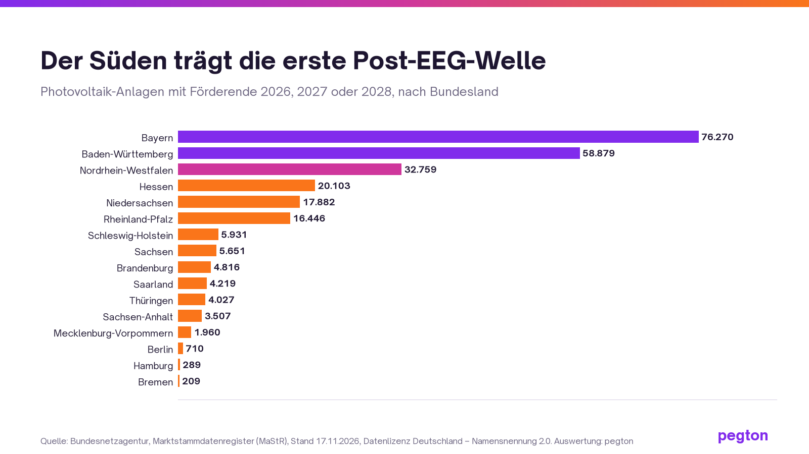

# Post-EEG / Ü20 Photovoltaik in Deutschland – offene Daten nach Kreis

[](LICENSE)
[](https://www.marktstammdatenregister.de)
[](#methodik)
[](datapackage.json)

*English summary below.*

Für Photovoltaik-Anlagen, die 2000–2008 in Betrieb gingen, endet die 20-jährige EEG-Vergütung in den Jahren 2020–2028.
Dieses Repository enthält die **aggregierten Zahlen für alle 400 Kreise und kreisfreien Städte**, alle 16 Bundesländer und alle Größenklassen.
Es sind CSV-Dateien, frei nutzbar unter CC BY 4.0, zum Beispiel für Journalismus, Kommunen, Energieagenturen, Forschung oder eigene Karten.

| Jahr des Förderendes (31.12.) | Anlagen | MWp | Anteil privat | Anteil Volleinspeisung |
|---:|---:|---:|---:|---:|
| 2020 | 7.478 | 31,5 | 88,3 % | 78,7 % |
| 2021 | 17.903 | 84,5 | 87,1 % | 81,7 % |
| 2022 | 15.587 | 95,4 | 84,0 % | 81,3 % |
| 2023 | 17.457 | 127,4 | 87,6 % | 80,6 % |
| 2024 | 42.676 | 588,5 | 88,1 % | 81,6 % |
| 2025 | 62.244 | 864,0 | 86,9 % | 85,1 % |
| **2026** | **62.318** | **831,8** | **87,6 %** | **97,8 %** |
| 2027 | 76.351 | 1.247,0 | 86,6 % | 98,4 % |
| 2028 | 114.989 | 1.969,5 | 86,8 % | 98,4 % |
| **Summe** | **417.003** | **5.839,6** | 87,0 % | 92,2 % |



**Kreise mit den meisten Anlagen (Förderende 2020–2028):** Heilbronn (4.865), Passau (4.755), Ansbach (4.592), Ravensburg (4.561), Schwäbisch Hall (4.459), Rottal-Inn (4.440), Ortenaukreis (4.272), Biberach (4.108), Ostallgäu (3.980), Unterallgäu (3.960).

## Dateien

| Datei | Inhalt |
|---|---|
| [`data/kreise_uebersicht.csv`](data/kreise_uebersicht.csv) | 1 Zeile je Kreis (400): Anlagen je Förderende-Jahr 2020–2028, ausgefördert bis 2025, gesamt, kWp |
| [`data/kreise_nach_eeg_ende.csv`](data/kreise_nach_eeg_ende.csv) | Langformat Kreis × Jahr: Anlagen, kWp, Anteil privat, Anteil Volleinspeisung |
| [`data/bundeslaender_nach_eeg_ende.csv`](data/bundeslaender_nach_eeg_ende.csv) | Bundesland × Jahr |
| [`data/deutschland_nach_eeg_ende_und_groesse.csv`](data/deutschland_nach_eeg_ende_und_groesse.csv) | Deutschland × Jahr × Größenklasse (kWp) |
| [`datapackage.json`](datapackage.json) | Metadaten und Schema ([Frictionless Data](https://frictionlessdata.io/)) |

`kreis_ags` ist der fünfstellige amtliche Kreisschlüssel. Damit lassen sich die Daten direkt mit Karten (z. B. Kreisgrenzen des BKG) verbinden.
Achtung: Manche Namen kommen doppelt vor (z. B. Stadt und Landkreis Würzburg). Verbinden Sie deshalb immer über `kreis_ags`.

```python
import pandas as pd
url = "https://raw.githubusercontent.com/Zapparelo/post-eeg-solar-germany/main/data/kreise_uebersicht.csv"
df = pd.read_csv(url, dtype={"kreis_ags": str})
print(df.nlargest(10, "anlagen_ende_2026")[["kreis_name", "anlagen_ende_2026"]])
```

## Methodik

- **Quelle:** Öffentliche Einheitenübersicht des [Marktstammdatenregisters](https://www.marktstammdatenregister.de) der Bundesnetzagentur, Energieträger Solare Strahlungsenergie, Abruf am 17.11.2026.
- **Auswahl:** Anlagen mit Inbetriebnahme 2000–2008, in Betrieb. Das Förderende ist der 31.12. des Jahres *Inbetriebnahme + 20*.
- **Privat:** Anlagenbetreiber ist eine natürliche Person (Feld `AnlagenbetreiberPersonenArt`).
- **Volleinspeisung:** Anteil der Anlagen mit Einspeiseart „Volleinspeisung“.
- **Kreis:** aus dem Gemeindeschlüssel der Anlage (die ersten 5 Stellen). Der alte Schlüssel 03152 (Göttingen) wurde auf 03159 umgeschlüsselt. Das Bundesland ergibt sich aus den ersten 2 Stellen.
- **Grenzen:** Das MaStR enthält Selbstangaben der Betreiber. Nachträgliche Registrierungen, Stilllegungen und Fehleingaben verändern die Zahlen laufend. Abweichungen zu anderen Auswertungen sind deshalb möglich.
- **Datenschutz:** Es sind nur Summen enthalten, keine Einzelanlagen, keine Namen und keine Adressen.

Ausführliche Erläuterungen und Rechenbeispiele stehen auf [zapparelo.github.io](https://zapparelo.github.io/), zum Beispiel:
[Post-EEG-Anlagen in meinem Landkreis: Ranking 2026–2028](https://zapparelo.github.io/post-eeg-anlagen-landkreis/) ·
[Was am 1. Januar 2027 passiert](https://zapparelo.github.io/ue20-solaranlage-was-tun/) ·
[Methodik](https://zapparelo.github.io/methodik/)

## Feiner aufgelöst oder selbst abrufen

- **PLZ- und Gemeinde-Ebene** (8.054 PLZ, 10.078 Gemeinden) mit Excel-Rechner und Vertriebs-Playbook: [Ü20-Solar-Atlas](https://pegton.gumroad.com/l/ue20-solar-atlas) (kostenpflichtig)
- **Gewerbliche und kommunale Anlagen ab 30 kWp** mit Betreiber: [Post-EEG Gewerbe-Liste](https://pegton.gumroad.com/l/post-eeg-gewerbe-liste) (kostenpflichtig)
- **Kostenlose 10-Punkte-Checkliste für Betreiber:** [Post-EEG-Check](https://pegton.gumroad.com/l/post-eeg-check)
- **Eigene Abfragen** (Solar, Speicher, Wind nach PLZ, Datum und kW) mit Neu-Anlagen-Monitor: [MaStR-Scraper auf Apify](https://apify.com/pegton/mastr-energy-units)

## Zitieren

> pegton (2026): Post-EEG / Ü20 Photovoltaik in Deutschland nach Kreis. Datenstand 17.11.2026. https://github.com/Zapparelo/post-eeg-solar-germany. Datenquelle: Marktstammdatenregister, Bundesnetzagentur (dl-de/by-2-0).

---

## English summary

Open, aggregated data on **417,003 German rooftop and ground-mounted PV systems** (commissioned 2000–2008) whose 20-year EEG feed-in tariff ends between 2020 and 2028.
The data covers all 400 German districts (Kreise), 16 states and size classes, as CSV under CC BY 4.0.
It is derived from the Bundesnetzagentur's public Marktstammdatenregister (data as of 17 Nov 2026) and contains no individual units or personal data.
62,318 systems (832 MWp) lose their tariff on 31 Dec 2026, 76,351 in 2027 and 114,989 in 2028. 98 % of these still feed all their power into the grid.
The column `kreis_ags` holds the official 5-digit district code.
